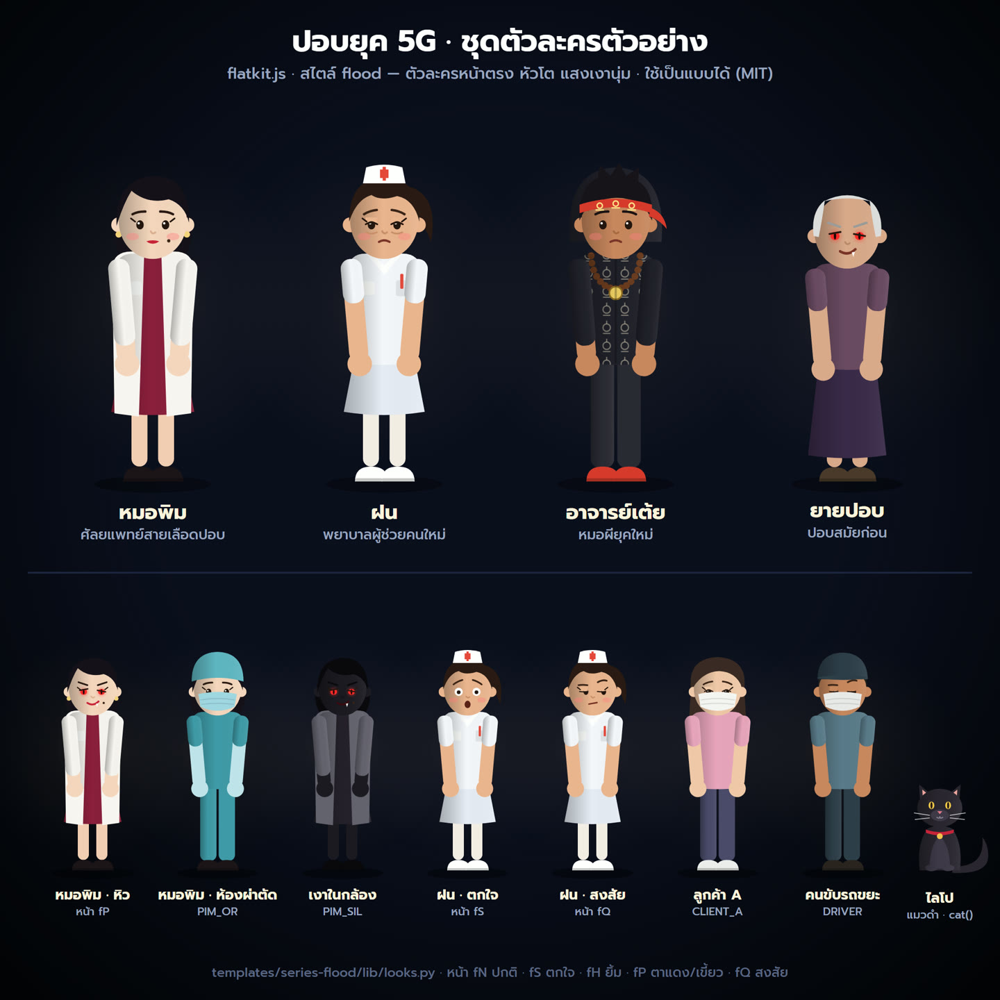
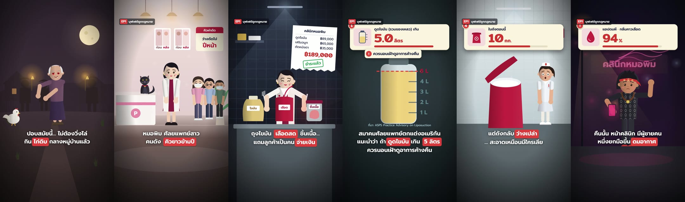
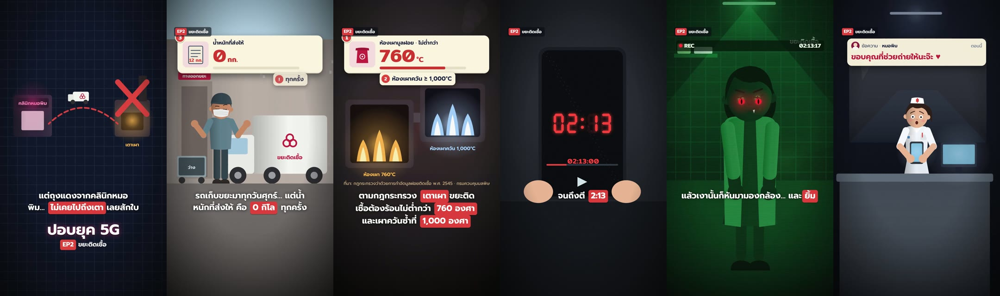

# Storytelling Motion

ให้ **Claude Code หรือ Codex ทำคลิปเล่าเรื่องแนวตั้ง 2D Motion Graphic** แบบเป็นซีรีส์ ตั้งแต่คอนเซปต์ประโยคเดียว → บท 5 ช่วง → เสียงพากย์ที่ล็อกเสียงเดิมทุกตอน → ฉากแอนิเมชันด้วย HyperFrames → ตรวจ → เรนเดอร์ 4K60






## มีอะไรบ้าง

- **โครงเล่าเรื่อง 5 ช่วง** (Hook → Setup → Rising → Climax → Cliffhanger) + เทคนิค 6 ข้อ + ข้อเท็จจริงจริงตอนละ 1 ข้อพร้อมแหล่งที่มา
- **สไตล์ภาพ flood** (`scripts/flatkit.js`): ตัวละครหน้าตรงหัวโต แสงเงานุ่ม ลำแสง vignette เกรน การ์ดความรู้สีครีม ซับป้ายแดง หน้าเปลี่ยนได้ (ปกติ/ตกใจ/ยิ้ม/ตาแดง/สงสัย)
- **หลักความลื่นทุกช็อต**: กล้องซูมช้า + parallax, ตัวละครหายใจ/โยก/กะพริบตา, แสงไหว, easing นุ่ม, cross-dissolve 0.3 วิ
- **โครงสร้างแบบโมดูล** (`scripts/scenekit.py`): ฉากละไฟล์ ไทม์ไลน์อิงจุดเสียง ซับจากเวลาเสียงจริง เปลี่ยนเสียงแล้วทุกอย่างตามเอง
- **เสียงพากย์ Gemini TTS** ล็อกน้ำเสียงทั้งซีรีส์ด้วย seed + เครื่องมือตัดช่วงเงียบ/จับเวลา/เว้นจังหวะ
- **เสียงประกอบ CC0** จาก freesound พร้อมบันทึกที่มา
- **ตัวอย่างพร้อมใช้**: ชุดตัวละคร "ปอบยุค 5G" (`templates/series-flood/`) และสองตอนตัวอย่าง (`examples/pop5g-ep1`, `examples/pop5g-ep2`) — ตัวละครเหล่านี้ใช้เป็นแบบได้ตาม MIT

## ติดตั้ง

วางข้อความนี้ใน **Claude Code** หรือ **Codex**:

```text
ติดตั้ง Storytelling Motion จาก https://github.com/thomas3p/storytelling-motion
อ่านและทำตาม INSTALL.md ใน repository นั้น ติดตั้ง skill และสร้าง workspace ให้พร้อมใช้
ตรวจว่ามี Node.js, Python 3.10+, ffmpeg แล้ว ให้ฉันตั้ง GEMINI_API_KEY เอง ห้ามขอหรือแสดงคีย์
```

หรือติดตั้งเอง:

```sh
git clone https://github.com/thomas3p/storytelling-motion.git
cd storytelling-motion
python install.py --agent claude --workspace "<โฟลเดอร์งาน>"
```

## เริ่มทำคลิป

```text
/storytelling-motion สร้างซีรีส์ใหม่: <เรื่องย่อ> บอกแผนว่ากี่ตอนจบ แล้วเริ่มตอนแรกเลย
```

ดูตัวละครตัวอย่าง: เปิด `examples/characters/characters.html` ในเบราว์เซอร์ (แก้ `templates/series-flood/lib/looks.py` แล้วรัน `python examples/characters/build_sheet.py --png`)

## สิ่งที่ต้องมี

| งาน | เครื่องมือ |
|---|---|
| สร้าง/เรนเดอร์วิดีโอ | Node.js 18+ (`npx hyperframes`), Chrome |
| เสียง | ffmpeg/ffprobe ใน PATH, `pip install soundfile librosa faster-whisper` |
| เสียงพากย์ | Gemini API key ของคุณเอง (ตัวแปร `GEMINI_API_KEY`) |
| เรนเดอร์เร็ว (ไม่บังคับ) | GPU NVIDIA สำหรับ `--gpu` |

## ลิขสิทธิ์

โค้ดและตัวละครตัวอย่างใช้ [MIT License](LICENSE) · ไม่รวมฟอนต์/เสียง/เสียงพากย์ใน repository (ฟอนต์ OFL ดาวน์โหลดด้วย `scripts/get_fonts.py`, เสียง CC0 ดาวน์โหลดจาก freesound ตอนทำงาน) · ชื่อคลินิก/ตัวละครเป็นเรื่องสมมติ
